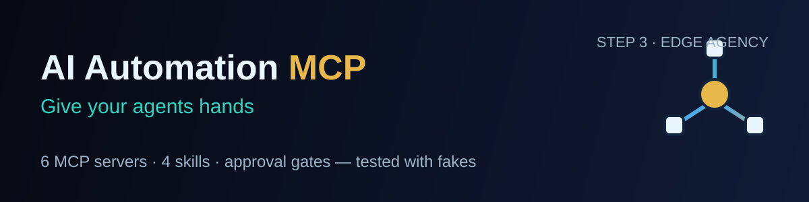

<p align="center">
  
</p>

<h1 align="center">AI Automation MCP</h1>

<p align="center">
  <strong>Give your agents hands — MCP servers and skills that connect AI agents to real tools, safely.</strong>
</p>

<p align="center">
  
</p>

<p align="center">
  <a href="https://github.com/EdgeAgent/ai-automation-mcp/actions/workflows/ci.yml"></a>
  <a href="https://www.python.org/"></a>
  
  
  <a href="LICENSE"></a>
</p>

**Step 3 of the AI Automation series.** [Step 1 — the AI Automation Starter Kit](https://github.com/EdgeAgent/ai-automation-starter) gave you the foundation, and [Step 2 — AI Automation Agents](https://github.com/EdgeAgent/ai-automation-agents) gave you agents that think in recipes. This repository gives those agents **hands and trades**: six MCP servers that connect them to real tools — lead lists, quotes, files, the web, a phone, a CRM — and a pack of Agent Skills that teach them how to do the jobs safely. Every server runs end to end on fake backends: no network, no API keys, no paid calls, and no real phone calls, ever, in demo or test.

> These are production *patterns* in runnable form, not hosted services. The servers are reference implementations in the spirit of the official MCP reference servers: they demonstrate the protocol and the safety patterns, and your deployment owns provider accounts, credentials, and the decision to wire a live backend.

## What you can do

- Run **six MCP servers** in a numbered build order — deterministic local tools first, network next, the approval-gated phone tools last — over stdio, for any MCP client (Claude Code, Claude Desktop, Cursor, Codex, Windsurf).
- Speak the **real protocol**: a small standard-library core implements the initialize handshake, tools, resources, prompts, and ping as JSON-RPC 2.0 — no SDK between you and the wire.
- See **annotations used as a safety surface**: every tool declares read-only / destructive / idempotent / open-world hints, so a client can show a human what a tool may do before it runs.
- Watch an **approval guard** refuse a phone call that lacks `approved: true` — the backend is never touched — then approve it and get a clearly fake record back.
- Install **four Agent Skills** that pair discipline with capability: check a lead list, quote-then-invoice, triage an inbox (draft-only), and run phone outreach under guardrails.
- Validate any skill with `ai-mcp validate-skill`, and add **Server 07** and **Skill 05** — yours — from the guides in `docs/`.

## The six servers

Numbered in build order — a learning path, not just a list. Start at 01: the first three servers need no backend at all, so they run the minute the repo is cloned.

| # | Server | What it does | Tools | Backend | Sends anything? |
| --- | --- | --- | --- | --- | --- |
| 01 | `lead-tools` | Check and grade a lead list before outreach (dedupe, flags, A/B/C grades) | `check_lead_list`, `score_lead` | None — pure local logic | No — local only |
| 02 | `business-tools` | Deterministic quote and invoice math in exact Decimal arithmetic | `build_quote`, `create_invoice` | None — pure local logic | No — documents only |
| 03 | `notes-files` | Read, write, and search notes inside one sandboxed directory | `write_note`, `read_note`, `list_notes`, `search_notes` | Local filesystem (sandboxed) | No — local only |
| 04 | `web-fetch` | Fetch a page and return readable text; failures are errors, never faked | `fetch_url` | Injectable HTTP client | No — reads only |
| 05 | `phone-tools` | Approval-gated call/SMS tools shaped like a real provider API | `place_call`, `send_sms` | **Fake backend only** (cannot dial) | Gated — approved actions only, fake backend |
| 06 | `mini-crm` | A tiny local JSON CRM: add, fetch, list, and log activity on leads | `add_lead`, `get_lead`, `list_leads`, `log_activity` | Local JSON file | No — local only |

Every server also exposes the context around its tools — a **resource** (the grading rubric, the invoice terms, the fetch policy, the phone policy, the CRM summary) and, where natural, a **prompt** — because a server that is only tools teaches half the protocol.

## Quick start

You need Python 3.11+. No API key is needed for anything below — demos and tests run on fakes.

```bash
git clone https://github.com/EdgeAgent/ai-automation-mcp.git
cd ai-automation-mcp
python -m pip install -e ".[dev]"
```

```bash
ai-mcp servers                       # the six, in build order
ai-mcp demo                          # boot all six on fakes, call them through the protocol
ai-mcp validate-skill skills/lead-list-checker
python scripts/demo.py               # the same demo, no install needed
```

### Connect a server to your MCP client

Servers run on stdio; your client launches them. For example, Claude Desktop / Cursor style configuration (more in [`examples/`](examples/)):

```json
{
  "mcpServers": {
    "lead-tools": {
      "command": "ai-mcp",
      "args": ["run", "lead-tools"]
    },
    "mini-crm": {
      "command": "ai-mcp",
      "args": ["run", "mini-crm"],
      "env": { "AI_MCP_CRM_PATH": "/home/you/.ai-mcp-crm.json" }
    }
  }
}
```

Or start one yourself to watch it wait for a client (stdio servers print a one-line notice to stderr and then listen — that "hang" is the protocol working):

```bash
ai-mcp run lead-tools
ai-mcp run notes-files --notes-dir ./mcp-notes
ai-mcp run web-fetch --allow-domain example.com
```

Copy `.env.example` to `.env` to set the default paths (`AI_MCP_NOTES_DIR`, `AI_MCP_CRM_PATH`, `AI_MCP_FETCH_ALLOWLIST`). Never commit `.env`.

## The servers, one by one

### Server 01 — lead-tools

CSV in → cleaned CSV out, plus grades. Dedupe by normalized email (phone fallback), flag problems per row (`invalid_email`, `missing_phone`, …), grade A (ready) / B (usable with a gap) / C (incomplete). `score_lead` grades one lead with its reasons. The rubric is a resource (`rubric://lead-grading`) so a client can read the rules before trusting the grades, and the `outreach_plan` prompt encodes the routine: rubric first, check second, outreach only after a human confirms.

### Server 02 — business-tools

Job details in → an itemized quote out, computed in `Decimal`: line items, labor, markup, tax, totals, and a deposit/balance split that always sums to the total. `create_invoice` runs the same math as a numbered invoice with issue/due dates, kept in an in-memory ledger. JSON numbers are converted through `Decimal(str(value))`, so 19.99 stays 19.99 — money documents must recompute cent-for-cent. Terms ship as a resource (`templates://invoice-terms`); the `quote_request` prompt gathers the job before pricing it.

### Server 03 — notes-files

The sandbox is the lesson. Every path is resolved against one workspace directory, and anything that would land outside — `..` segments, absolute paths — is refused before a byte moves; the tests try to break out and fail. `write_note` is annotated destructive (it overwrites); reads, listing, and search are read-only. A `notes://index` resource and a `summarize_note` prompt round it out.

### Server 04 — web-fetch

One tool, honestly bounded: fetch a URL through an injectable HTTP client, strip scripts/styles, return title + readable text. An optional domain allowlist restricts hosts. A failed fetch returns an error with the reason — content is never invented to fill a gap. The tool is read-only but annotated open-world: with the live httpx backend it really does reach the network. The fetch policy is readable as `docs://fetch-policy`.

### Server 05 — phone-tools

The dangerous end of the path, built to teach the guardrails. The tools are shaped like a real provider API, and two things stand between a model and a ringing phone:

1. **The approval guard, in code.** `place_call` and `send_sms` require `approved: true` in the tool arguments. Without it the tool errors and the backend is *never invoked* — the tests prove the backend stays untouched.
2. **The annotations.** Both tools are marked destructive and open-world, so any client can warn before the call is even attempted.

Only a **fake backend** ships: it records intent and returns records marked `fake`. Wiring a live provider (Vapi, Twilio, …) means implementing the `PhoneBackend` protocol with your own account — and keeping the guard. The outreach policy is a resource (`policy://phone-outreach`); the `phone-outreach-guardrails` skill carries the scrub discipline that goes with it.

### Server 06 — mini-crm

A tiny CRM as a server: leads in one local JSON file, four tools, no network, no account. `add_lead` returns sequential ids (`lead-0001`, …), `get_lead` fetches by id or email, `log_activity` appends timestamped history. This is the safe pattern for CRM-shaped tools — one file you own, every write a tool call a client can log — and it scales to a real CRM by swapping the store, not the tools. Counts are exposed as `crm://summary`.

## The skills pack

Servers are hands; **skills** are trades — a folder with a `SKILL.md` (frontmatter `name` + `description`, then instructions) and bundled references an agent loads on demand.

| Skill | The job | Pairs with |
| --- | --- | --- |
| `lead-list-checker` | Grade and clean a list before outreach; report first, contact only the grades a human approves | Server 01 |
| `quote-and-invoice` | Build the quote, stop for approval, then create the invoice from the approved quote — never re-keyed | Server 02 |
| `inbox-triage` | Classify urgent / routine / spam and draft replies; never sends — a handoff list for a human | Step 2, Recipe 07 |
| `phone-outreach-guardrails` | The scrub + approval + reporting discipline for any call or text | Server 05 |

Validate any of them (and your own) with:

```bash
ai-mcp validate-skill skills/lead-list-checker
ai-mcp validate-skill skills/templates/skill-template   # the starting point for Skill 05
```

## Develop and test

```bash
python -m pip install -e ".[dev]"
ruff check .
ruff format --check .
pytest
```

The tests drive every server through the real protocol — an in-process client performs the initialize handshake, lists tools, and calls them — with fake backends injected. They make no network calls, need no API keys, spend no money, and place no phone calls. The GitHub Actions workflow runs the same checks on Python 3.11, 3.12, and 3.13. A standalone demo lives at [`scripts/demo.py`](scripts/demo.py) (run it with `python scripts/demo.py`).

## What this does — and does not do

The protocol core is a real, minimal MCP implementation: JSON-RPC 2.0 over stdio, version negotiation, tools/resources/prompts, spec-shaped errors. It is deliberately not the official SDK — the point of Step 3 is to see the wire. It speaks **stdio only**; Streamable HTTP is documented in [`docs/architecture.md`](docs/architecture.md) as the same dispatch behind an HTTP shell, and is left out because remote MCP needs auth and session decisions that deserve their own step.

The demo backends are fakes, and they say so: the web-fetch demo reads canned pages, and the phone backend **cannot dial anything** — its records are marked `fake`. Live wiring is real work that stays with you: an httpx backend ships for fetch, but a live phone provider means your account, your compliance duties (consent, do-not-call, calling hours), and your bill. The approval guard is a pattern, not a compliance program.

Annotations are hints a client *should* honor; a hostile client can ignore them, which is why the phone guard is enforced in the handler. The skill validator checks the format's structural rules (frontmatter, name, description, folder match) with a deliberately small parser for flat fields — it is not a general YAML parser and does not judge whether a skill's instructions are *good*. The mini-CRM is a teaching store: one JSON file, no locking beyond atomic rewrites, no multi-user anything.

## Repository layout

```text
.
├── .github/workflows/ci.yml        # Python matrix tests and package build
├── assets/                         # Icon, banner, and social preview (SVG)
├── docs/                           # Architecture, Server 07 guide, Skill 05 guide
├── examples/                       # MCP client configs: Claude Desktop, Claude Code, Cursor
├── scripts/demo.py                 # Standalone end-to-end demo on fakes
├── skills/                         # The skills pack (SKILL.md folders + template)
│   ├── lead-list-checker/
│   ├── quote-and-invoice/
│   ├── inbox-triage/
│   ├── phone-outreach-guardrails/
│   └── templates/skill-template/
├── src/ai_automation_mcp/
│   ├── protocol.py                 # JSON-RPC / MCP constants and error codes
│   ├── server.py                   # The MCP server core (stdio, stdlib only)
│   ├── client.py                   # In-process client harness for tests and demos
│   ├── backends.py                 # HTTP / phone backend protocols, real + fake
│   ├── config.py                   # AI_MCP_* settings for live runs
│   ├── skills.py                   # SKILL.md parser and validator
│   ├── demo_data.py / demo.py      # Sample inputs and the six-server demo
│   ├── cli.py                      # The ai-mcp CLI
│   └── servers/                    # Servers 01–06, one module each + registry
├── tests/                          # Protocol-level, fakes-first tests for everything
├── PUBLISHING.md                   # Repo description + topics for publish time
└── pyproject.toml                  # Package metadata and install profiles
```

## Contributing

Install the development profile, run the checks above, and keep the default install lean. When adding a server, follow [`docs/build-your-own-server.md`](docs/build-your-own-server.md) — one job per server, backends behind protocols, truthful annotations, a guard on anything that acts, tests through the protocol. When adding a skill, follow [`docs/build-your-own-skill.md`](docs/build-your-own-skill.md) and make sure `ai-mcp validate-skill` passes. See [`CONTRIBUTING.md`](CONTRIBUTING.md).

## Repository and license

Step 1: [github.com/EdgeAgent/ai-automation-starter](https://github.com/EdgeAgent/ai-automation-starter) · Step 2: [github.com/EdgeAgent/ai-automation-agents](https://github.com/EdgeAgent/ai-automation-agents). This repository is not published to PyPI; clone it and use the editable install commands above. Released under the [MIT License](LICENSE). Publishing notes (description, topics, social preview) live in [`PUBLISHING.md`](PUBLISHING.md).
